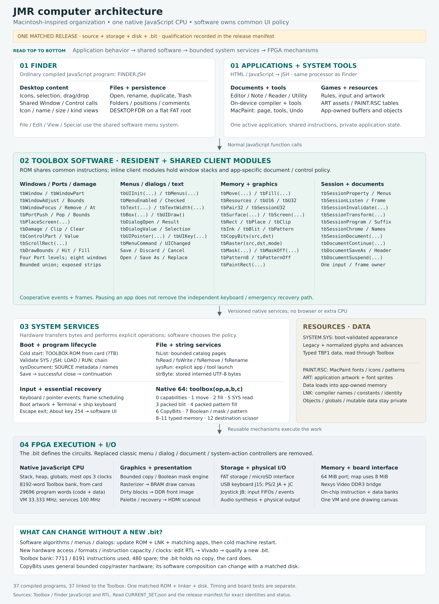

# JMR computer architecture

What the machine is and who owns what. Modules: [RTL_REORG.md](RTL_REORG.md). Build status: [FPGA_FIT.md](FPGA_FIT.md). Other diagrams: [diagrams/](diagrams/README.md).

## The machine

A custom processor in the FPGA executes compiled JavaScript directly. There is no 68000, no browser and no interpreter. The VM runs at 33.333 MHz. Graphics engines, storage, memory and video run at 100 MHz. External memory is reached through a port with a 25-bit word address (64 MiB); the map below uses its first 8 MiB. The picture is 640×480 with 8-bit pixels through a 256-entry palette.

At power-on the machine shows a startup picture and loads Finder from the card. There is no command prompt.

## Layers

| Layer | What it is | Owns |
|---|---|---|
| Finder and applications | Ordinary compiled JavaScript programs (`.JSH`) on the card. One runs at a time. | Finder: icons, selection, windows, folders, desktop state. Applications: their documents, rules and artwork. |
| Toolbox | Shared JavaScript loaded at boot from `TOOLBOX.ROM` into its own 8192-word instruction bank. Programs call it like any function. | Windows, menus, dialogs, text, drawing composition, sessions. |
| System services | Hardware services a program reaches through native calls. | Files, SOURCE text, program launch, input events, frame timing. |
| FPGA engines | The circuits in the bitstream. | Instruction execution, heap, raster and copy engines, storage, input, display, sound. |

Each program has its own objects and state. The Toolbox shares instructions, not data.

`SYSTEM.SYS` holds appearance data (fonts, captions). `PAINT.RSC` holds MacPaint tables. Neither is executable. See [SYSTEM_RESOURCES.md](SYSTEM_RESOURCES.md).

Toolbox files, calls, capacities and how to build it: [RESIDENT_TOOLBOX.md](RESIDENT_TOOLBOX.md). Call reference: [TOOLBOX_API.md](TOOLBOX_API.md).

## Loader and supervisor

- `jmr_console_engine` is the loader. It loads programs, holds SOURCE text, runs the on-machine compiler chain and serves host file transfers. It takes typed requests. It has no command parser, prompt or pager.
- `jmr_finder_shell` is the supervisor. When a program exits or fails, the machine returns to Finder. It keeps a one-byte exit status that Finder reads at start ([SYSTEM_APPLICATIONS.md](SYSTEM_APPLICATIONS.md#exit-status)) and shows as an alert.
- To switch programs the loader halts the old VM and waits for its acknowledgement before loading the next.
- If Finder fails, it is started once more and shows the alert. If it fails again before it opens anything, a read-only recovery text display appears. The keyboard path and the system menu with its on-screen keyboard are hardware, so they still work when a program hangs.

## Host file transfer

A computer on the PROG cable can send files while Finder is in front. Finder paints a receiving panel and yields to the transfer service. Progress and errors show on the host. A running application is not stopped for an upload.

- A transfer is complete when the file close is acknowledged. Finder then refreshes.
- A payload rejected for a bad CRC can be sent again.
- An interrupted transfer needs a board reset before new commands.
- `TOOLBOX.ROM` and `TOOLBOX.LNK` cannot be sent individually. Install a full matched card.

Protocol: [ARCH_MONITOR.md](ARCH_MONITOR.md#finder-service-requests).

## What needs a new bitstream

| Change | Needs |
|---|---|
| Menu layout, dialogs, filename behaviour, drawing composition, masks, brushes | New `TOOLBOX.ROM` + `TOOLBOX.LNK`, every client program relinked, then a cold restart. Restarting a program does not reload the ROM. |
| A program's own behaviour | That program's file on the card. |
| Pixel format, a new memory port, bank sizes, native call interface, clocks | RTL change and a new qualified bitstream. |

Spare block RAM does not enlarge the Toolbox bank or add a hardware capability.

## How it differs from a Macintosh

The model is the original Macintosh split between applications, Toolbox and system.

- The Toolbox is loaded from the card at boot, not fixed in ROM.
- Bulk graphics mechanisms are hardware; graphics policy is software.
- Resources use small explicit formats. There is no Resource Manager and no binary compatibility.
- The supported JavaScript subset and the code, heap and binding limits are fixed: [JMR_JS_COMPATIBILITY.md](JMR_JS_COMPATIBILITY.md).

## Memory

On-chip block RAM holds the heap, application code, the Toolbox bank, the draw canvas and fonts. It is separate from the external window below.

External memory, 8 MiB, byte offsets (the RTL constants in `jmr_js_vm_pkg.sv` are 16-bit word addresses: half these numbers):

| Bytes | Use |
|---|---|
| 0 – 6,860,800 | Artwork |
| 6,860,800 – 7,057,408 | Finder executable cache (192 KiB) |
| 7,057,408 – 7,131,136 | Parked Finder state |
| 7,131,136 – 7,155,712 | `SYSTEM.SYS` payload |
| 7,155,712 – 7,462,912 | Front image shown on HDMI (640×480) |
| 7,462,912 – 7,495,680 | Work area |
| 7,495,680 – 7,643,136 | Compiler and shared arena (73,728 bytes, one per word) |
| 7,643,136 – 7,774,208 | SOURCE (65,536 bytes, one per word) |
| 7,774,208 – 8,388,608 | Image and compile staging (307,200 bytes, one per word) |

Programs draw into the on-chip canvas. `jmr_fb_present` copies it to the front image, and `jmr_fb_scanout` reads the front image for HDMI.

On the board the port maps the first 64 MiB of the 512 MB DDR3 (`jmr_ddr3_sram_bridge`). In the simulator it is `jmr_sram_model`. A board with 64 MB HyperRAM needs only a bridge with the same port.

The card image is separate from this: `tools/make_sd_image.py` sets its size.

## An ASIC later

Not current work; do not start a smaller-FPGA port, a shuttle or an off-chip heap from this note. If it is picked up: a small die with VGA output (a small pad ring has no HDMI serializers) and one external asynchronous RAM chip behind the existing port. The 307,200-byte draw canvas, the heap and the code stay on-chip: programs write the canvas one pixel per clock, and heap reads from slow external memory would need a cache. Move colder data (art, SOURCE, staging) out first. A program never sees memory banks. The sibling BASIC computer's plan (`JMR-BASIC-FPGA-COMPUTER/docs/plans/arch_3.0_external_sram.plan.md`) has 44 user pins, of which a 1 MB × 8 RAM takes 30; this machine's 25-bit × 16-bit port would not fit that package as it stands.

## Board connections

Jacks and pins: [USB_KEYBOARD_PMOD_MICE.md](USB_KEYBOARD_PMOD_MICE.md). Board facts and loading: [FPGA_BRINGUP.md](FPGA_BRINGUP.md).
