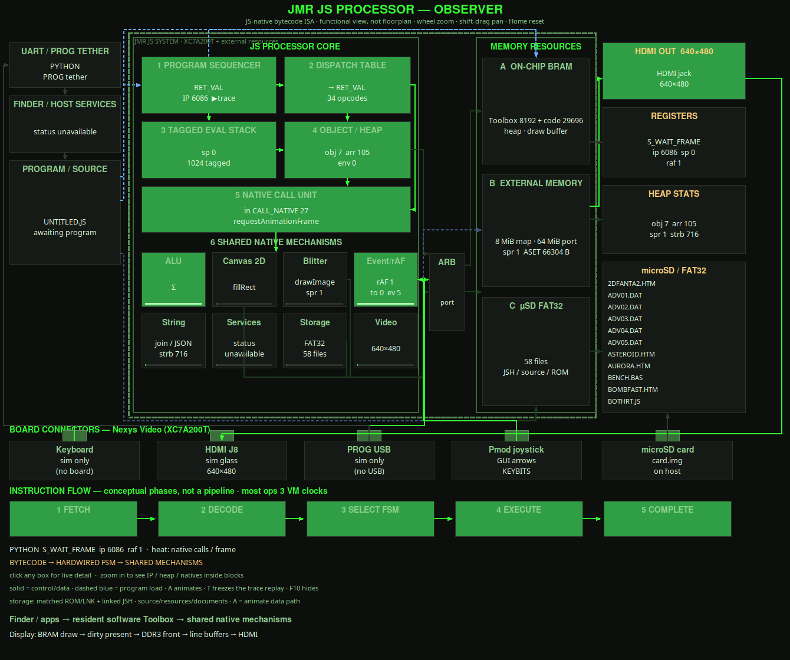

# Architecture Monitor

**F10** in the GUI opens the Architecture Monitor (`gui_arch_monitor.py`): a live diagram of the machine with heat on the blocks that are working. It only observes. Running the GUI: [GUI_RUNTIME.md](GUI_RUNTIME.md).

## Using it

| Action | Result |
|---|---|
| Click a block | Opens the Inspector for that block |
| Mouse wheel | Zoom |
| Middle-drag, right-drag or Shift-drag | Pan |
| `H` or Home | Reset the view |
| `A` | Toggle the moving packets |
| `T` | Toggle replay of executed instructions |

The diagram is a functional view, not a floorplan. The five instruction boxes are phases of one hardwired state machine, not a pipeline. Since build 99 most instructions take 3 VM clocks; the EXECUTE inspector says which. Measured clocks per instruction: [NEXT_BUILD.md](NEXT_BUILD.md#build-99-fewer-clocks-per-instruction), profiler `sim/cpi_profile.py`.

Memory blocks:

- **A On-chip BRAM**: the Toolbox bank (code addresses 0–8191, filled from the card's `TOOLBOX.ROM` at cold start; the bit holds no copy), the program bank (8192–37887), heap and draw buffer.
- **B External memory**: a 25-bit word port (64 MiB); the memory map uses the first 8 MiB. On the board it is DDR3, in FPGA-SIM `jmr_sram_model`.
- **C µSD**: the card.

## Where the data comes from

The monitor reads `backend.arch_snapshot()` every frame. Inspector windows read `backend.arch_peek(name, …)`, and `backend.arch_decode(ip)` names the instruction at an address. Each runtime fills these from a different place.

| Runtime | Source | What you get |
|---|---|---|
| PYTHON | The functional model's VM (`Machine._hw_vm`) | Everything |
| FPGA-SIM | Simulator commands (`VMSTAT?`, `PROF?`, `IPTRACE?`, `VRING?`, peeks) | Everything |
| BOARD | Telemetry lines on the PROG cable | State, fault, address, pool counts, fault forensics. No memory contents. |

A field shown as `—` was **not transmitted**. It does not mean zero. On BOARD most Inspector fields are `—`.

Notes for FPGA-SIM:

- Between frames the VM is nearly always waiting for the next frame, so one sampled state says little. `PROF?` returns the RTL's own count of clocks per state, and the block heat comes from that.
- `IPTRACE` records the addresses actually executed during a frame. Replay uses it.
- `VMSTAT?` gives state and address but no opcode. The monitor decodes the opcode from the compiled program at that address.
- A new simulator command must be added to `_OPTIONAL_VERBS` in `runtime/sim_backend.py`, or every refusal from an older simulator is logged as a fault.

Capacities shown in the panels are imported from `hardware_model.js_vm` and `functional_model.jsb_format`, which mirror the RTL. Never type them in. The external port width has no Python mirror; it is `EXT_PORT_ADDR_BITS` in `gui_arch_monitor.py`.

## BOARD

The cable and port: [FPGA_BRINGUP.md](FPGA_BRINGUP.md#prog-cable-tether). The bitstream sends text lines. `runtime/board_backend.py` parses them and ignores a torn line.

| Line | Content | When |
|---|---|---|
| `S<row>:<64 chars>` | One row of the recovery text display | Continuously, about every 42 ms per full dump |
| `K<code 2>` | A scancode arrived from the J15 keyboard | Each key byte |
| `V<state 2><fault 2><address 4>` | VM heartbeat | After each screen dump, on a fault, and about every 0.67 s |
| `H<8>` | Live pool counts: environments (10 bits), arrays (11), objects (11) | With every `V` |
| `F<16>` | Fault forensics: allocator kind, retried flag, state, call depth, stack depth, then the pool counts at the fault | Once per fault |
| `T<32>` | Last eight executed addresses, newest first | Once per fault |
| `G<12>` | Fault site (16 bits) and the value that was refused (32 bits) | Once per fault |
| `E<storage 2><loader 2><time 4>` | Storage state, loader state, duration of the last storage operation | About every 1.34 s and on a change |
| `D<state 2>` | Storage state during a stall | After about 0.67 s of continuous storage activity, then repeating |
| `Q<24 hex><CRC 8>` | Reply to a Finder service request | Per request |

HDMI is the picture. The board does not send framebuffer pixels over the tether. The GUI shows the `S` text rows. On BOARD the monitor's HDMI block reads "640×480" because that is the jack, not because the pixels arrived on the cable.

### Reading a fault

A fault is a deliberate halt. A halt and a hang look the same on the screen; the `V` line tells them apart.

| Fault code | Meaning |
|---:|---|
| 1 | Stack or heap overflow |
| 2 | Call stack overflow |
| 3 | Out of capacity: no free object, array or environment slot, or a program too large to load |
| 4 | Bad or stale handle (generation mismatch) |
| 5 | A removed JSON path was reached |
| 6, 7 | Value stack overflow, or nearly full |
| 8 | Other overflow counter |
| 9 | Program image or operation refused |

Codes 1, 2, 3, 6 and 8 are also raised by the overflow counters at the end of `jmr_js_vm.sv`. The `G` site says which assignment fired.

- `F` kind says which allocator failed: 0 object, 1 array, 2 function, 3 environment. `retried` says whether a forced garbage collection already ran.
- `G` site is the number stamped at the faulting assignment: search `fault_site <= 16'd<site>` in `rtl/engines/jmr_js_vm.sv` and `jmr_js_vm_exec64.sv`. A refused value exactly equal to a region's size means a loop ran off the end. A small negative value means an unset index.
- `T` does not record jumps, and its newest entry can be the instruction after the fault.
- State numbers: `jmr_js_vm_pkg.sv` for the VM, `storage_engine.sv` for storage, `jmr_console_engine.sv` for the loader. Storage `00` is idle, `02` is error, `09` is waiting on the card.

The GUI shows the fault in the status line and in the REGISTERS and PROGRAM SEQUENCER inspectors. The HEAP inspectors show the `H` counts against capacity.

### Check the telemetry is alive first

With the machine idle you should see `V` lines and a storage beat with state `00`. If they are missing, the link is dead and silence means nothing.

A stale card looks like a VM bug: the board runs the program on the card, not the one in `storage/`. [Check the card first](FPGA_BRINGUP.md#the-card).

### What BOARD cannot show

Heap and object contents, the per-state profile, and live instruction replay. The `T` trail is eight entries, captured only at a fault. Reproduce in FPGA-SIM to see more. The Python model has no object pool limits, so it cannot reproduce a capacity fault.

### Finder service requests

File transfer and launch from the host use typed requests, not typed commands or screen matching (`runtime/finder_tether.py`).

- Request: byte `FA`, then a 23-byte body (version, operation, transaction, argument, name) and a CRC32.
- Reply: a `Q` line with version, operation, transaction, phase, status and value, and a CRC32.
- Operations: status, enter Finder, save source, save large file, launch, stream program, query transaction, catalog.
- A status reply with bit 6 set means an interrupted transfer: reset the board before sending more.

## Flight log

Every session writes `traces/session_<time>_<RUNTIME>.log`. On BOARD each parsed line leaves a note (VM state, fault, trail, storage beat, key), so a session can be reconstructed afterwards.

## Keyboard block

The Keyboard block lights on real key activity, not on a sampled VM state: the GUI stamps its own key presses, the BOARD backend stamps `K` lines, and the newer of the two wins.
