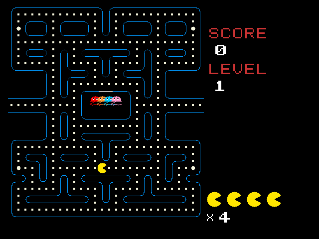
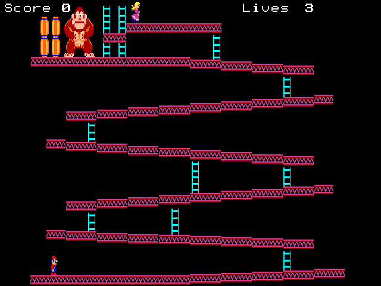

# Native JavaScript game speed recovery

Baseline: Git `38b6da1`, 2026-10-26. The native Value64 JavaScript CPU remains
the execution engine. The fabric stays at 100 MHz and the VM divisor stays
at seven. Heap capacities, language features, game rules, art, audio,
resolution, and the persistent BRAM canvas are retained.

## Standard release

Promoted on 2026-10-26 at the user’s request after a reported working
board/tether setup. [Standard release and persistent flash](STANDARD_RELEASE.md).
The original build-time manifest’s “not programmed” status records its
creation time; promotion is recorded in `releases/standard.json`. Numeric
board FPS has not been measured.

## Measured performance

These are elapsed **100 MHz fabric clocks** from actual Verilated RTL,
using `SRAM_INTERNAL=1`. They include CPU, collection, drawing, and present
work, but **exclude real MIG latency and board scanout contention**. FPS is
uncapped cycle-derived capacity, not measured board FPS or simulator wall
speed. The board now explicitly paces callbacks at approximately 60 Hz.
The inherited method-cache synthesis issue described below is another
reason these raw RTL cycle figures must not be presented as board FPS.

| Workload | Before median | After median | Median gain | Before p95 | After p95 | p95 gain |
| --- | ---: | ---: | ---: | ---: | ---: | ---: |
| Pac-Man, frames 5–64 | 4,749,990 | 1,264,375 | 3.76× | 4,771,459 | 1,286,992 | 3.71× |
| Donkey Kong, frames 900–929 | 3,458,245 | 1,095,381 | 3.16× | 3,486,056 | 1,105,447 | 3.15× |

The source-level profiler's 90-frame later-play phase reduces median
dynamic bytecode work from 61,646 to 4,471 operations for Pac-Man and from
20,208 to 5,890 for Donkey Kong. These operation counts explain the removed
search/call work; they are separate from elapsed RTL cycles, which also
include collection, drawing, and memory transfers.

Median capacity rises from 21.05 to 79.09 FPS for Pac-Man and from 28.92 to
91.29 FPS for sustained Donkey Kong. The longest sampled Pac-Man frame
falls from 143.59 to 77.34 ms; this remaining pathfinding/reset spike is
not concealed by the median. Donkey Kong's sampled maximum falls from
34.92 to 11.09 ms. The sustained Donkey replay starts the title and
character selection with distinct Enter presses, then runs without held
movement input. Pac-Man auto-starts; Enter would pause it.

Reproduce using `tools/measure_game_rtl.py`, retaining the baseline binary
and original JSH images for comparisons. Raw campaign logs and samples
live under `build/speedup/`. Compact release evidence is saved under
`docs/performance/`.

## Changes and reasons

* Pac-Man level seeds use digit strings, decoded to the same independent
  numeric live maps on create/reset. All 12 layouts and 372 seed rows are
  retained. This frees 372 persistent arrays and removes the original
  151-word code-trailer overflow. Consumed pellets are recorded once in
  bounded chunks, eliminating full-grid redraw searches. Ghost-home BFS
  retains its order and algorithm, with local scalar scratch and a
  power-of-two queue pitch. The background snapshot covers the complete
  maze and pellets, with the two empty outer bands cleared locally.
* Both Donkey art variants retain their original collision order and exact
  overlap tests. Conservative platform/ladder bands narrow background
  searches. Tile ranges, cached immutable platform bounds, invariant world
  scale, batched collision calls, and overlapping dirty-box unions remove
  repeated work. Platform bounds and dirty-box extents are cached, and the
  identical tile-row overlap test runs once per platform. Unusual dimensions and invisible-wall-sensitive cases
  retain conservative fallbacks.
* Ordinary Number multiplication skips fixed groups of 32, 16, or 4 zero
  bits, otherwise consuming one bit. Each step preserves the exact
  accumulator-plus-remaining-product invariant. This removes both variable
  barrel shifters from the first candidate while retaining its whole-frame
  speedup. Existing 106-bit product, normalization, and rounding remain.
  Date.now retains its independent background engine.
* Framebuffer present pipelines registered BRAM reads through a four-word
  FIFO and hands off SRAM requests on acknowledgement. ImageData restores
  similarly remove request bubbles. Arbitration remains preemptible at
  every accepted word; framebuffer and snapshot layouts remain compatible.
* A sticky per-array reference bit allows collection to omit element walks
  only when no reference has ever been stored in that array's lifetime.
  Reference writes set it; invalidation clears it. Generation checks,
  registered reads, queueing, and array sweep remain in place.
* The board frame counter is sized from its parameter and explicitly uses
  a 1,666,666-clock period. This corrects the old 65,536-clock setting, which
  would otherwise accelerate frame-based motion as execution improves.

## Preservation and gates

The final source replay executes product-minted ProgramImages in the
Value64 hardware model: 900 frames each for PACFAST, DNKF, and DNKFAST,
2,700 total. Every framebuffer byte and the checked semantic game state
match the baseline. Initial geometry matches for every Pac-Man level.
Input covers movement, jumping, climbing, pause/resume, and title selection.
This is substantial deterministic coverage, not a claim that every possible
play-through or all late-level transitions have been exhaustively tested.
An additional 540-frame replay drives the real stage-reset method through
all 12 mazes, the final screen, and Enter restart; pixels and checked state
match throughout. The identical validation driver is injected into both
versions for this test and is absent from the shipped games.
Direct original-versus-selected RTL runs match all 307,200 RGB pixels at
Pac-Man frame 64 and Donkey Kong frame 19, including both Donkey art
variants. The Pac-Man sample follows the expensive ghost-path work. The
baseline and selected binaries and images are retained under the campaign
directory; these comparisons execute both hardware revisions.

The final images have zero code-BRAM overflow:

| Title | Operations | Code bytes | Whole product image |
| --- | ---: | ---: | ---: |
| PACFAST | 7,272 | 45,184 | 45,960 |
| DNKF | 6,054 | 37,176 | 1,697,896 |
| DNKFAST | 6,054 | 37,216 | 2,374,122 |

Focused RTL checks cover immediate multiply consumers and exact raw Number
results, deep stacks, sprite scaling/odd source offsets/re-upload, clipping,
ImageData round trips, references reachable through copied/filled/long
arrays across collection, and the actual board frame-counter period.
The selected RTL's complete regression and controller checks passed:
**549 passed, 12 skipped, 2 existing expected failures, and 1 existing
non-strict unexpected pass** (564 cases total, no failures). The native RTL
shard uses `sim_build_release3`. The latest Donkey scalar-cache changes
also pass both 900-frame source/pixel/state replays and direct native
frame-19 pixel comparisons. Per-test card isolation prevents
probe accumulation and concurrent runs from contaminating card loads.
An old test tied to Pac-Man's exact overflow size now uses a synthetic
ASET-padded image, preserving the original executable-vs-trailer gate.

The real present and DDR3 bridge RTL passed independent command/data-ready
stalls, delayed read responses, queued swaps, clear, exact byte packing,
and final write-combine coherence. The real raster/bridge pair also passed
full-screen ImageData, one-pixel rows, clipping, mirroring, and source cap.
Under the test's 25-clock read delay, full ImageData restore took 1,702,222
clocks. This is an isolated bridge test, not a board frame measurement.

A sparse long-array reference write at index 35 was found to fail equally
in the original and optimized RTL. It is outside these game changes; its
baseline comparison is retained in the campaign logs. Existing prefetch
experiments were rejected when they failed correctness and remain disabled.

## Physical build status

The selected fixed-step implementation **passed physical acceptance** and
produced `build/nexys_video/jmr_nexys_video.bit` and `.bin` for
`xc7a200tsbg484-1`. Final results:

| Check | Result | Campaign limit |
| --- | ---: | ---: |
| Setup slack | **+0.238 ns**, zero failing endpoints | ≥ 0 |
| Hold slack | **+0.050 ns**, zero failing endpoints | ≥ 0 |
| LUTs | **92,273** | 95,000 |
| Occupied slices | **28,583** | 28,602 |
| BRAM tiles | **353.5 / 365** | 355.5 |
| DSPs | **128 / 740** | Unchanged |
| Bitstream DRC errors | **0** | 0 |

Routing completed in **35 minutes 48 seconds**; synthesis took 39 minutes
29 seconds, placement 5 minutes 55 seconds, and physical optimization
1 minute 53 seconds. The final source fingerprint matches the synthesized
and published design. The accepted bitstream, routed checkpoint, reports,
and source archive are preserved in
`build/runs/run72b_game_speedup_WNS+0.238/`; checksums and build parameters
are in `docs/performance/2026-10-26-fpga-release.json`.

The build uses `Congestion_SpreadLogic_medium`, `ExploreArea`, two synthesis
workers, and eight implementation threads. These settings, resource limits,
and the 45-minute implementation watchdog are now Makefile defaults.
Raw synthesis used 96,904 LUTs, 3,277 fewer than the variable-shift candidate,
and passed the 105,000 raw-LUT ceiling. Placement used 92,150 LUTs / 28,553
slices; estimated East congestion was level 5 at 108%.

Area is checked after placement before routing. Sources and defines are
fingerprinted before synthesis, checkpoint reuse, and publication. The
controller recognizes partial placement status and can resume a verified
placed DCP without repeating synthesis or placement.

Earlier variable-shift multiplier candidates did not produce a qualified
bitstream. Their checkpoints remain under
`build/speedup/variable_shift_checkpoints/`. They provide build evidence,
not release artifacts:

| Candidate | LUTs | Slices | BRAM | Result |
| --- | ---: | ---: | ---: | --- |
| First preflight, before final raster handoff | 93,095 | 28,226 | 353.5 | Placement only; estimated setup -0.495 ns |
| Compact, final raster handoff | 90,459 | 26,998 | 353.5 | AlternateCLB route stopped at 45-minute watchdog; Default comparison stopped at 25 minutes |
| Medium spread, final raster handoff | 90,722 | 28,506 | 353.5 | Route stopped at 30 minutes |

Medium placement reported no level-5 hotspots, but its router still found
congestion. Its short global iteration 0 was skipped, not evidence of a
faster completed route. The selected fixed-step implementation removes
the variable barrel shifters while retaining the measured whole-game
speedups. BRAM remains unchanged from the recorded run-71c baseline.
A high-spread placement of the selected netlist was rejected before routing
at 28,930 slices and worse 115% East congestion. The secondary Default
router was stopped after the primary implementation passed all gates.

The 33 synthesis critical warnings are inherited duplicate reset writers
for `cmc_valid` and `cmc_wp` in `jmr_js_vm_exec64.sv`. Vivado preserves a
constant-zero driver, omitting the optional class-method lookup cache;
the complete lookup fallback remains functional. This release preserves
that baseline mapping. A future single-writer repair would need its own
area/timing qualification, because enabling the currently pruned cache
adds logic. The Verilated RTL can exercise that cache, so actual board
performance remains a required hardware measurement.

Both the new bitstream and updated game JSH/card image are required for the
combined speedup. The FPGA has not been programmed by this task. Board FPS,
real input play-through, and board memory/scanout behavior remain hardware
acceptance checks after the build.

## DDR latency sensitivity

The actual board DDR bridge was also connected to the full native core in a
private simulation overlay, using an always-ready MIG application model
with a 25-cycle read delay. Pac-Man's median improved from 5,863,592 to
1,924,272 fabric clocks (**3.05×**); sustained Donkey Kong improved from
3,641,029 to 1,244,117 (**2.93×**). The Pac-Man frame-64 output matches every
RGB pixel. This exposes the remaining memory cost; the model does not drive
live HDMI scanout and is not a measurement of board FPS.

`tools/build_ddr_latency_sim.py` builds this overlay without changing product
RTL. Use `--ref 38b6da1 --build sim_build_ddr_before` for the baseline and
`--build sim_build_ddr_after` for the working tree, then pass the resulting
binary and an explicit `--memory-model` description to
`tools/measure_game_rtl.py`. The tool-built binary reproduced all recorded
VMSTAT fields for the first measured Pac-Man frame. Full samples are saved
in `docs/performance/2026-10-26-ddr-latency.json`.

## Native RTL visual checks

