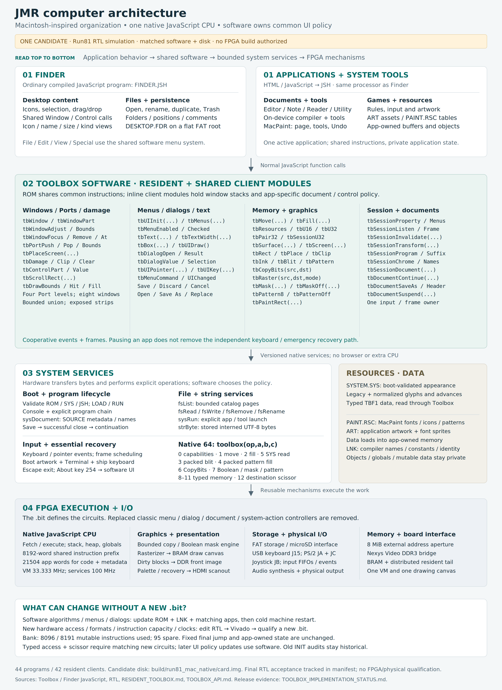

# JMR computer architecture

The software revision contains **44 programs, including eight CB variants;
42 clients share the Toolbox**. Four runnable teaching programs demonstrate
native graphics operations (GRAPHICS), background restoration (DAMAGE), manual
UI ownership (UIMAN), and cooperative session ownership (UISESS). Their ROM,
LNK and resident clients form one matched set; delivery/readback status belongs
to its release manifest. The library uses **8096 of 8191 mutable words, leaving 95 spare**.

**Run81 is the one active implementation/RTL-simulation candidate**. Its
software tree is `build/run81_mac_native/source/storage/`; its matching disk is
`build/run81_mac_native/card.img`. No FPGA build or physical update is authorized
for this step. Root published software and older builds remain preserved records,
not competing test candidates. RTL checks do not establish board acceptance.
User testing confirmed working menus and several games, and exposed graphics
and intermittent pointer regressions. Targeted RTL checks cover the earlier
nine software fixes. Earlier checkpoints have actual RTL GRAPHICS/cold-ROM evidence. Current shared-manager software passed focused native-instruction-model checks and the final combined RTL simulation against its exact frozen ROM and disk. FPGA routing/timing and physical acceptance remain separate.
Exact identities and bounded evidence are in
[TOOLBOX_IMPLEMENTATION_STATUS.md](TOOLBOX_IMPLEMENTATION_STATUS.md).
There is one canonical architecture diagram; the separate
[memory map](diagrams/memory-map.png) describes addresses.

Finder and applications are ordinary compiled JavaScript programs on the same
native processor. Finder owns icons, selection, window arrangement, catalog
views, folders and desktop persistence. Editor, Note, Reader, Utility and
MacPaint own document behavior; games own their rules and artwork. Disabled
Finder operations remain disabled: familiar labels do not promise a complete
Macintosh implementation.

The resident Toolbox contains reusable executable JavaScript. Its UI section
owns windows, menus, dialogs, filename editing, save decisions and common tool
navigation. Its graphics section composes bounded bulk primitives. System
services provide bytes, files, SOURCE metadata and explicit program handoff.
The FPGA provides instruction execution, memory access, raster/copy engines,
input, storage and display. `SYSTEM.SYS` holds appearance data; `PAINT.RSC`
holds MacPaint tables. Neither is Toolbox executable code.

## What differs from Macintosh, and why

Our reference is the original Macintosh's application/Toolbox/system
organization. [Inside Macintosh, Volume I (1984)](https://bitsavers.org/pdf/apple/mac/Inside_Macintosh_Vol_1_1984.pdf)
describes shared ROM routines and trap dispatch. We use that separation of
responsibilities, with native JavaScript calls and a small versioned hardware
interface suited to this FPGA.

- **Boot-loaded instructions replace fixed ROM routines.** `TOOLBOX.ROM` is
  validated and loaded into a dedicated instruction bank. Software calls it
  normally. It can change without a new bit, provided the hardware interface
  already supports the work and the library fits. Every resident client must
  be relinked against the same ROM/LNK and the machine restarted. Mutable
  state and objects remain per application.
- **Bulk graphics mechanisms stay in hardware; graphics policy stays in
  software.** CopyBits needs canvas read/write access. Merely adding code to
  the old ROM could not supply that missing hardware port. The qualified run78 bit adds
  the general bounded copy/raster interface now. Subsequent CopyBits or UI
  algorithms using it can change through a matched disk update. Spare BRAM
  alone cannot add new formats or hardware capabilities.
- **Common UI is now software in the clean core.** The replaced native menu,
  dialog, document and system-action controllers are removed. Boot artwork,
  Terminal and the ship/keyboard recovery path remain independent so an
  application failure cannot remove emergency access. The earlier statement
  that migration was still awaiting native UI removal described the older
  mixed implementation; it is not the target architecture here.
- **Resources use small explicit formats.** SYS provides verified shared
  appearance data; app resources load into app-owned memory. This keeps
  storage and validation bounded. There is no Macintosh Resource Manager or
  binary compatibility claim.
- **Execution is native compiled JavaScript on one custom processor.** There
  is no 68000, browser or interpreter. The supported JavaScript subset and
  fixed code/heap/binding limits remain explicit.

Moving UI policy out of RTL makes software algorithms updateable; it does not
change configured FPGA circuits. Run81 combines bounded RTL changes and a matched
software/resource revision for simulation. Applying changed circuits to the board
would require a later authorized Vivado build and qualification. No routed area,
strict timing or physical result is claimed for this unbuilt candidate. Earlier
factory INIT audits stay tied to their original checkpoints and ROMs.

The text revision preserves legacy SYS bytes 0..20607 and adds normalized glyphs
and canonical advances in the existing payload tail. It removes the per-miss
32-read/32-write byte swap without adding an application font allocation. Widths
remain available before UI initialization. The per-app 32-byte glyph scratch,
single session/input/frame ownership and public calls stay unchanged. This candidate also implements shared Window/Control geometry, four-level drawing Ports, rectangular Damage and exposed-strip scrolling. Optional policy modules are actual inline client software. It does not implement arbitrary Macintosh Regions or a binary-compatible resource ABI. Dispatch counts are not speed factors.

## Update boundary

Run81 adds typed-memory and destination-scissor mechanisms. Its software requires the matching new RTL; older run78 operations 1–7 alone are insufficient. Once this interface is included in a qualified bit, changing menu layout, filename behavior,
CopyBits composition, masks, patterned brushes or shape algorithms can use
ROM + LNK + relinked applications, then a cold machine restart.
Finder/Game Restart reopens a program and does not reload the shared ROM. Changing a pixel format,
physical memory permission/port, bank size, native ABI or clocks requires RTL,
Vivado and a new qualified bit. See [RESIDENT_TOOLBOX.md](RESIDENT_TOOLBOX.md)
for exact files, calls, memory, capacities and build steps, and
[TOOLBOX_API.md](TOOLBOX_API.md) for bitmap descriptors and native contracts.

The operating clocks remain 33.333/100 MHz and external memory remains 8 MiB.
Finder's executable cache grows from 160 to 192 KiB to hold the larger linked
image. This reserves 32 KiB from artwork capacity; the art limit becomes
6,860,800 bytes. SYS, framebuffer, saved Finder arena and SOURCE addresses stay
fixed. All shipped assets have been checked against the revised boundary.
The resident prefix is 8192 words, with 8191 mutable instructions and one fixed
jump. The revised library uses **8096 mutable instructions, leaving 95 spare**.
Larger additions may still need replacement or compaction of existing routines.
The fixed final jump cannot be used for an extra instruction. Available BRAM
elsewhere does not enlarge this configured bank; a larger bank requires a new bit.
Application runtime code/metadata retains 21504 physical words.

## Menu and program-switching corrections

Finder paints indexed RGB332 pixels. Its former shared white style resolved
to title-palette index 1, which RGB332 displays as dark blue. Shared UI uses
Finder's white index 255 and cyan index 31; title palettes retain white 1/cyan 6.
Active menu titles and enabled hovered rows draw inverse text on black. Disabled
labels use black/white stipple and cannot highlight or dispatch an action;
a disabled checked item retains a black check marker. No identical Macintosh
styling claim is made. Selected Finder filenames use white SYS glyphs on black; a focused check
preserves that reverse selection after About closes and after cached return.
About key 254 is handled by the application software. The native Terminal path
is separate from the disk applications' shared session.

Application switching requires both session cooperation and the console's
halt/acknowledgment protocol. Removing five listeners and stopping future
frames was insufficient in run78: the console could replace code while the old
VM was still running. Run79 explicitly halts the old VM and waits for its busy
acknowledgment to clear before loading the next program. Actual full-core RTL
Finder → Editor → Finder checks passed again in run81; run79's negative setup
slack still prevents a strict timing-qualified claim.

The intermittent physical mouse jumps remain a separate regression. A dropped
pointer-report mechanism was reproduced; run81 retains the snapshot correction. That is evidence for a possible mechanism, not proof of the
reported board cause or of an accepted hardware fix. No idle-only simulation
can close that report.

Publish the revised `storage/`, disk and card only with matching ROM/LNK/clients.
Both original and CB game versions remain available while the user tests them.
The disk builder defaults to **64 MiB** so the complete assets fit. This changes
SD storage capacity; the running machine still has its **8 MiB** memory aperture.

## Board connections

Current jacks match `rtl/top_nexys_video.sv` (`USB_MOUSE=0`): USB keyboard on
**J15**, PS/2 mouse on **JA**, second PS/2 mouse on **JC**, joystick on **JB**.
Mouse data is pin 1 and clock is pin 3. Details are in
[USB_KEYBOARD_PMOD_MICE.md](USB_KEYBOARD_PMOD_MICE.md).

Earlier architecture prose, including the original detailed SYS example and
board notes, is preserved in [the historical capture](run77_ARCHITECTURE_HISTORY.md).
Its development limits and native UI ownership do not describe run78.

