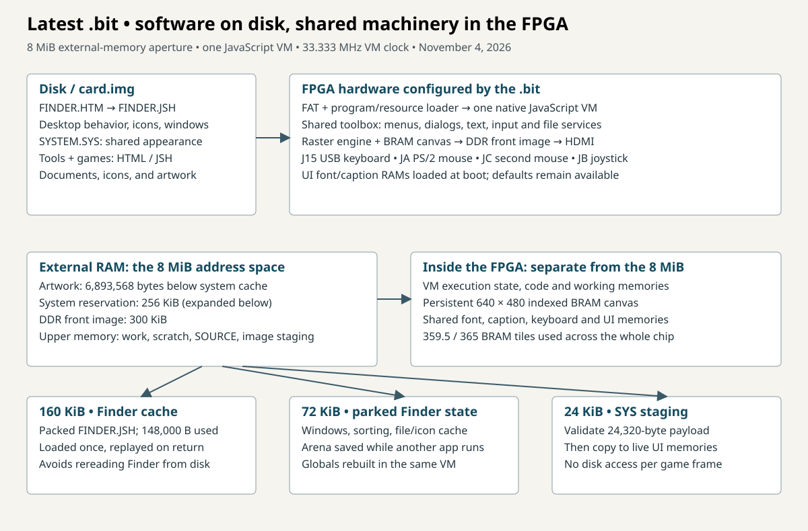
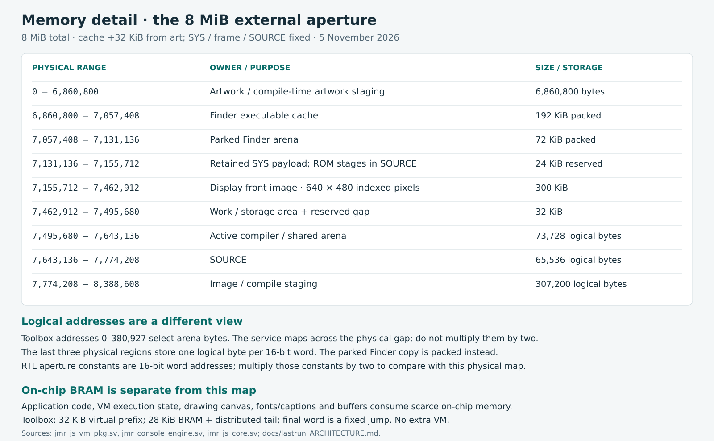
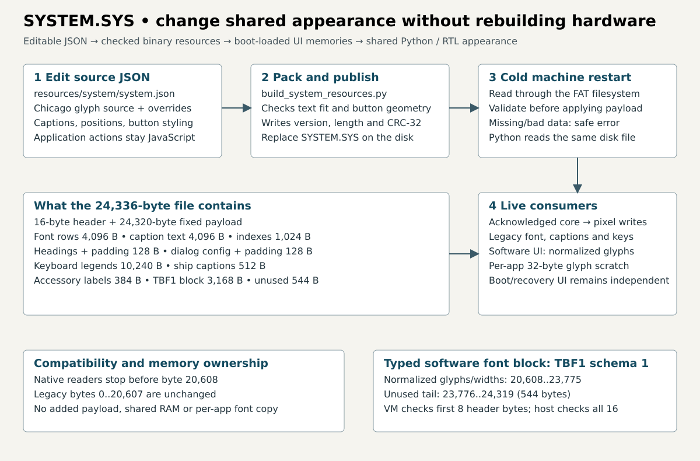

# Historical architecture notes before the run78 documentation update

This is a preserved historical capture. For the current machine, use
[the run78 architecture](lastrun_ARCHITECTURE.md). Limits, release status and
native UI ownership below describe earlier development work.

---

# Computer architecture and memory map

Read from top to bottom: **programs → shared Toolbox → system services → FPGA
mechanisms**. Finder is a JavaScript program on the same CPU as a game. Each
block expands one level to show responsibilities and calls. Arrows describe
responsibilities; programs can also call native services directly.



This is the **November 4 development source**, including the resident Toolbox
implemented in Python and RTL simulation. Run75/run76 bits do not contain native
Toolbox 64. **Run77d includes the new raw bitmap transport in this build**;
frozen run77b/run77c inputs do not contain it. Hardware qualification is tracked in
[TOOLBOX_IMPLEMENTATION_STATUS.md](TOOLBOX_IMPLEMENTATION_STATUS.md).
Released bits and build ownership are tracked in [FPGA_FIT.md](FPGA_FIT.md).

## How we organize the machine

- **Finder — desktop policy.** `storage/FINDER.HTML` owns icons, selection,
  overlapping windows, scrolling, sorting, virtual folders, file commands and
  Trash. Its File/Edit/View/Special declarations use the existing native menu
  UI. Folder membership, positions and comments persist in `DESKTOP.FDR`;
  the underlying FAT root remains flat. Print, Page Setup, Eject and Erase Disk
  remain disabled; familiar labels do not imply complete Macintosh features.
- **Applications and system tools — program behavior.** Editor, Note, Reader,
  Compiler, Utility, MacPaint and games run on the same native JavaScript VM.
  They own document/game algorithms and application commands. Utility builds
  and sorts its file catalog. TBDEMO demonstrates resident software UI; its
  Open/Save As dialogs demonstrate interaction, while actual file reads and
  writes remain the application's responsibility.
- **Toolbox — reusable executable routines.** `TOOLBOX.ROM` shares code for
  menus, a window frame, modal dialogs, Chicago text and memory/surface helpers.
  The diagram lists every public `tb*` function from `toolbox.js` and `ui.js`,
  grouped by purpose. These execute on the existing JavaScript CPU.
  `toolbox(op,a,b,c)` crosses native ID 64 into the hardware primitive engine.
  See [UI contracts](RESIDENT_TOOLBOX.md#shared-ui-calls) and
  [primitive/descriptor contracts](TOOLBOX_API.md) for arguments and limits.
- **System services — lifecycle, files, events and existing shared UI.**
  Boot validation, LOAD/RUN, compilation chains, Finder launch/return, FAT
  access, input/event delivery and emergency recovery belong here. `fsList`,
  `fsRead`, `fsWrite`, `fsRemove`, `fsRename` and `sysRun` are existing native
  APIs, separate from Toolbox operation numbers. Native menu/document/dialog/
  overlay controllers still serve Finder and unconverted applications.
  Choosing software UI transfers that application's ordinary UI ownership;
  it does not remove all native UI controllers from the machine.
- **SYSTEM.SYS — shared appearance data.** Glyphs, captions/indexes, fixed
  menu headings, native dialog settings and keyboard/ship/accessory captions
  are checked at boot. Native consumers use local loaded memories;
  `tbResources` reads the retained payload and software text uses its glyphs.
  Software dialog layout and matching hit testing live in `ui.js`; native
  dialog configuration does not control that software geometry.
- **FPGA mechanisms — execute and move data.** One JavaScript CPU, bounded
  copy/fill/packed-pixel services, rasterizer, drawing canvas, dirty-block
  presentation, scanout, memory bridge, storage, input and audio implement the
  machine. The VM remains at 33.333 MHz and services at 100 MHz. Python is the
  functional model; FPGA-SIM runs product RTL. Board qualification is separate.

## What differs from Macintosh, and why

Our reference is the **original 1984 Macintosh organization**, rather than
modern macOS: Finder and applications above shared UI/graphics routines and
lower-level system services. Apple's
[Inside Macintosh, Volume I (1984)](https://bitsavers.org/pdf/apple/mac/Inside_Macintosh_Vol_1_1984.pdf)
describes Toolbox/OS routines and ROM trap dispatch. The
[original QuickDraw source preserved by the Computer History Museum](https://computerhistory.org/blog/macpaint-and-quickdraw-source-code/)
shows shared graphics implemented in 68000 assembly. We borrow the separation
of responsibilities, with these deliberate adaptations:

- **JavaScript is our processor's language.** Macintosh applications and
  Toolbox routines ran on a Motorola 68000. Our compiled JavaScript runs on
  the native JavaScript engine, including shared routines. This keeps the
  educational machine consistent from application to library without adding
  a browser or Macintosh binary emulation.
- **Our resident “ROM” is boot-loaded code.** Macintosh used ROM routines and
  trap dispatch. We load validated `TOOLBOX.ROM` instructions into a dedicated
  bank, call JavaScript helpers normally and use versioned native operations
  for bulk work. Shared UI code can change without rebuilding a Toolbox-capable
  bit. Clients must be relinked with the matching ROM, then the machine
  restarted. Mutable globals, constants and heap objects remain per application.
- **Resources have a deliberately bounded format.** The Macintosh Resource
  Manager organized typed resources. `SYSTEM.SYS` supplies a fixed, versioned
  appearance payload, rather than a general Resource Manager or executable
  system file. Python and RTL can check it before committing it. It supports
  the documented appearance edits; arbitrary controls, new actions and font
  metrics are not data-only changes. Software dialog behavior belongs in
  Toolbox code.
- **Bulk graphics run in reusable hardware.** Original QuickDraw was software
  on the 68000. We keep UI policy in JavaScript while native operations copy/
  fill bytes, expand packed pixels, clip/scale blits and fill patterns. This
  reduces repeated VM calls for our indexed-color display and packed document
  buffers. Native operation 6 now provides raw 8-bit rectangle transport
  between the drawing canvas and arena, with clipping and overlap handling.
  `tbCopyBits` is its software entry point. Packed expansion remains on
  operation 3. This subset is smaller than QuickDraw: general regions, full
  window/control managers and arbitrary resource-defined dialogs are not
  implied by the Macintosh-like section names.
- **Finder state is explicitly parked.** We keep one active application and
  one VM. Native return replays cached Finder code, reconstructs globals/
  functions, restores the arena and repaints. The software demo's
  `sysRun(pointer,8)` exit explicitly reloads Finder instead. Neither keeps
  a second running Finder heap. This reuses one execution engine and avoids
  disk rereads on the cached return path. A single-application workflow is
  a similarity to the early Macintosh; the cache/arena method is our choice.
- **Migration is incremental.** Software menus/dialogs are implemented, but
  native UI and hardware recovery remain. We can convert and verify programs
  individually while preserving working applications and emergency exit.
  This means two implementations currently coexist: converted programs run
  ordinary menu/dialog behavior as JavaScript; other programs still ask the
  existing hardware UI controllers. We should finish migration and verify
  programs before removing redundant circuits. Retaining emergency recovery
  is intentional. Removing circuits requires Vivado and a new bit. No RTL
  circuit changes happen through a ROM update, and net FPGA savings still
  require whole-chip measurement.

## The update boundary: software versus FPGA circuits

**This build adds a general bulk bitmap service. Graphics algorithms that use
it can subsequently change in software.** Native operation 6 copies bounded raw 8-bit rectangles between
arena memory and the existing drawing canvas. It reuses the canvas's synchronous,
write-priority read port; presentation keeps its separate port. It adds no
second canvas, no second VM and no additional external-memory allocation.
Existing Canvas `getImageData`/`putImageData` calls retain their image-object
paths; operation 6 works directly with raw arena bitmap descriptors.
The [exact descriptor and overlap rules](TOOLBOX_API.md#general-bitmap-transport-and-software-copybits)
are part of the interface.

After a bit containing this interface is built and qualified, Toolbox software
can capture pixels, operate on arena bytes and restore rectangles. Changes to
selection, scrolling, compositing or image algorithms can then use a new
`TOOLBOX.ROM` and matching relinked applications, followed by restart. Existing
packed-pixel expansion/scaling also remains available through operation 3.
This is a path for implementing more behavior in software, not a guarantee of
hardware acceleration for every future QuickDraw feature.
The current shared library uses 2473 words; the existing linker permits 598
additional instruction words within this bank. Client code and data limits
still apply, so software flexibility does not mean unlimited program space.

New hardware formats or ports, faster native raster modes, different memory
permissions and a larger resident instruction bank still require RTL changes,
Vivado and a new `.bit`. Free BRAM is only one resource constraint; it does not
create circuits or memory permissions. Editing RTL changes source; simulation
checks that source; Vivado builds the circuits used on the physical board.

Frozen run77b/run77c sources and previously ordered/released files are preserved.
Their running builds do not acquire this service from current source changes.
All current run77d/e/f/g/h/i candidates include this interface now, with the same
matched Toolbox ROM, relinked applications and audited disk. Their isolated
simulators pass the CopyBits and software-only ROM-update checks. Physical
timing and hardware acceptance remain open until qualification finishes; the
release will identify the selected hardware build and its matching disk.

## Board connections

Current board jacks, matching `rtl/top_nexys_video.sv` (`USB_MOUSE=0`):
USB keyboard on **J15**, PS/2 mouse on **JA**, second PS/2 mouse on **JC**,
joystick on **JB**. Pin 1 is mouse data and pin 3 is mouse clock.
`USB_MOUSE=1` is the older J15-mouse / JA-keyboard arrangement, kept so an
older bit can still be built. Details: [USB_KEYBOARD_PMOD_MICE.md](USB_KEYBOARD_PMOD_MICE.md).

## Who owns what

The `.bit` creates the CPU/VM, memory interfaces, graphics engines, input,
filesystem services and shared menu/dialog machinery. These are hardware.

`FINDER.HTM` is the disk source, compiled to `FINDER.JSH`. Finder draws and
manages the desktop, windows, icons, folders, sorting and Trash. Its executable
and saved arena live in external memory across application launches. Returning
replays the executable from RAM and restores the arena; globals/functions are
reconstructed. This is one running application at a time, not two VMs or a
fully suspended Finder heap. Repainting still takes time.

`SYSTEM.SYS` supplies supported shared fonts, captions and dialog settings.
It is data, not executable JavaScript. Python and RTL load the same file from
the mounted disk. Programs provide their own menu actions and About information
through `ctx.systemMenus` and `ctx.systemAbout`; system services handle shared
interaction and rendering. Editor, Reader, Compiler, Note and Utility combine
program behavior with those common services.

In the resident-Toolbox development build, cold boot validates and commits
TOOLBOX.ROM first, then SYSTEM.SYS, then loads Finder. The earlier SYS-capable
release boots SYS and Finder without a resident Toolbox bank.
The Enterprise startup display remains until Finder paints its first frame. Opening an application
parks Finder's arena. File → Quit restores Finder from RAM. Invalid/missing SYS
on cold start retains compiled-in resources. Restart after publishing new SYS
or Finder code; this release has no live resource reload command.

## What is in memory



The board uses a DDR-backed **8 MiB address aperture**. This is separate from
the FPGA's scarce on-chip BRAM. More external RAM does not automatically provide
more BRAM ports or remove placement congestion. The following addresses are
**physical byte offsets**, with end addresses excluded. RTL constants use
16-bit word addresses, so multiply those constants by two.

- **0–6,893,568:** packed artwork / compile-time artwork staging. Programs share
  this space; it is not a simultaneous cache of every game on disk.
- **6,893,568–7,057,408: 160 KiB Finder executable cache.** The shipped JSH is
  148,000 bytes, leaving 15,840 bytes in that fixed cache.
- **7,057,408–7,131,136: 72 KiB parked Finder arena.** File slots, windows, ordering, and comments survive while another program runs. Icon pixels in that cache are not trusted after a program such as MacPaint draws; the next Finder paint reloads them from disk.
- **7,131,136–7,155,712: 24 KiB SYS staging.** The payload uses 24,320 bytes,
  leaving 256 bytes. The 16-byte header is checked separately in registers.
- **7,155,712–7,462,912: 300 KiB DDR front image**, 640 × 480 indexed pixels.
- **7,462,912–7,495,680:** work/storage area plus its reserved gap.
- **7,495,680–7,643,136:** compiler/shared arena, 73,728 logical bytes stored
  one byte per 16-bit physical word. The parked Finder copy is packed; this
  active arena is not. These two sizes must not be confused.
- **7,643,136–7,774,208:** SOURCE, 65,536 logical bytes, one byte per word.
- **7,774,208–8,388,608:** image/compile staging, 307,200 logical bytes, one
  byte per word. Compiler use borrows regions when a game is not running.

Inside the FPGA are the VM execution memories/state, the persistent indexed
BRAM canvas, shared font/caption/keyboard memories and buffering/control logic.
The BRAM canvas and DDR front image have different jobs; adding a resident
Finder did not add another canvas or another VM. Files and original assets
remain on disk until loaded. A 32 MiB card image is storage, not 32 MiB of RAM.

## FPGA usage

Numbers for the qualified bit are on [FPGA_FIT.md](FPGA_FIT.md). Do not copy them here. Spare registers cannot stand in for BRAM. The VM clock is 33.333 MHz. Fabric and DDR stay at 100 MHz.

## What the architecture gained

Moving desktop policy into Finder removes the old dedicated desktop renderer
from the selected build and reuses the existing VM. Desktop changes become
program updates. The tradeoff is 232 KiB of external RAM for the cache and
parked state, plus execution/repaint time. Return avoids rereading Finder from
disk, but is not instantaneous.

SYS replaces fixed-only UI resources with boot-writable memories. Changing a
supported glyph, caption or button position updates both Python and RTL without
Vivado. It adds a loader, validation and write paths; it does **not** inherently
save RAM. The unused legacy About bitmap was separately removed during run75,
recovering four BRAM36 tiles in the isolated overlay synthesis. That is a local
measured saving, not a measured total saving from Finder alone.

There is no controlled old/new synthesis here isolating the Finder conversion
from all other changes, so no total LUT/BRAM saving is claimed. The clearest gain
is avoiding hardware rebuilds for many future UI improvements, not a promise
that every future hardware build will route faster. Current BRAM remains tight.

## SYSTEM.SYS in detail



The 24,336-byte binary has a 16-byte header and a fixed 24,320-byte payload.
The header identifies format 1, exact length and CRC-32. The payload contains
font rows; caption characters and indexes; fixed menu headings; dialog offsets,
button coordinates and style flags; pre-rendered keyboard/ship/accessory
captions; and reserved bytes. See [the exact format](SYSTEM_RESOURCES.md).

The loader validates the staged payload before transferring it to consumers.
An acknowledged clock-domain bridge commits display memory writes in the pixel
clock. Drawing subsequently reads local memories; it does not open the disk
on each pixel or game frame. Dialog hit regions use the corresponding settings,
so moving a supported button also moves its clickable area.

You can change glyph shapes within the existing Chicago metrics, captions,
whole-dialog offsets, button positions/widths, rounded corners and the default
button outline. You cannot add arbitrary dialogs, change font metrics, create
new actions or replace all game graphics with SYS. Finder's desktop lettering
is currently embedded in its program, independent of the shared menu font.
Startup text is resource-driven; the Enterprise silhouette/layout is hardware.

## A small Macintosh-inspired example you can actually try

Apple's [1984 Macintosh manual](https://vintageapple.org/macmanuals/pdf/Macintosh_1984.pdf)
shows the prompt “Save current document as”. Use that wording, retain Chicago,
rounded buttons and the outlined default, and arrange Cancel left / Save right.
This is an adaptation to our fixed dialog geometry, not an exact reproduction
of the original disk dialog or a claim that it provides all its controls.

A complete, packer-validated example is saved as
[macintosh-save.json](../resources/system/examples/macintosh-save.json).
The actual changes from today's configuration are:

```json
"147": "Save current document as:"
```

and, inside `dialog_buttons`:

```json
"save_as": [[400, 214, 84], [278, 214, 96], [0, 0, 0]]
```

Slots retain their identities: first is Save, second Cancel. Save has moved
right; the default outline and actions remain attached to Save. No extra pixels
are stored and the SYS file remains exactly 24,336 bytes. The example's font
path is adjusted only because it lives in the examples subdirectory.

The example has **not** replaced the release or your disk. To adopt it, make
those edits in `resources/system/system.json`, then run:

```sh
.venv/bin/python tools/build_system_resources.py --image card.img
```

Reopen Python, then test FPGA-SIM: File → Save As, inspect the prompt and
outline, click each relocated button, and confirm Save writes and Cancel leaves
the document alone. Copy the resulting SYSTEM.SYS to the board's disk and reboot
after simulator acceptance. No new `.bit` is required.

### Instructions to give an agent

> Read docs/SYSTEM_RESOURCES.md. Apply the Macintosh Save As example from
> resources/system/examples/macintosh-save.json to the production system.json:
> change prompt 147 and the two save_as button placements, retain font metrics
> and all action identities. Publish only SYSTEM.SYS to card.img, test Python
> and RTL Save/Cancel drawing and hit regions, and report the results. Do not
> rebuild the FPGA or change application code for this appearance-only edit.

No model training is required: these are editable resource settings. For a new
Finder behavior or application menu action, instruct the agent to change that
program's JavaScript and rebuild its JSH instead. For a new native primitive,
RTL and a new bitstream would be needed.

## Source of truth

Memory constants: `rtl/engines/jmr_js_vm_pkg.sv`,
`rtl/engines/jmr_console_engine.sv` and `rtl/jmr_js_core.sv`.
Format/validation: `tools/build_system_resources.py`. Resource source:
`resources/system/system.json`. Exact built hardware and reports are frozen
under the build folder named in [FPGA_FIT.md](FPGA_FIT.md). Diagrams describe ownership and flow, not physical
FPGA placement or a proportional drawing of memory sizes.

## Proposed next architecture

[Macintosh-style Toolbox and graphics RTL review](MAC_TOOLBOX_RTL_PLAN.md)
studies bulk drawing/copy services, software system tools and richer SYS
resources. It is a proposal, not a description of features in the current bit.


## Run77 development: resident executable Toolbox

The diagram above now includes the shared native-JavaScript instruction bank.
See [RESIDENT_TOOLBOX.md](RESIDENT_TOOLBOX.md) for the ROM format, linking,
software menu/dialog calls and update procedure. This bank is separate from
SYSTEM.SYS data. Its library implements policy in JavaScript; native service 64
implements bounded bulk memory and pixel operations. Unconverted applications
continue using the native UI controllers. This is an incremental migration,
not removal of every UI circuit.

The 16 KiB virtual bank uses 12 KiB of BRAM plus fixed jump padding. All
application code remains in BRAM. Application code capacity, 8 MiB
external memory and clocks are preserved. ROM boot loading temporarily reuses
SYS staging before SYS loads. Constants/globals/heap remain per application.
Whole-chip resource and timing claims require the run77 implementation reports;
see [build status](TOOLBOX_IMPLEMENTATION_STATUS.md). The earlier utilization
numbers in this document describe their named older releases.
